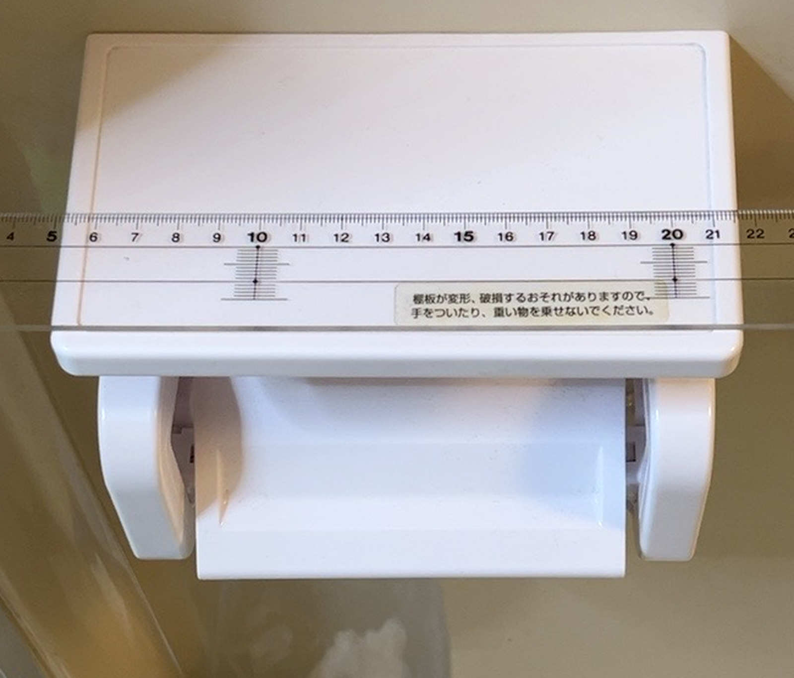
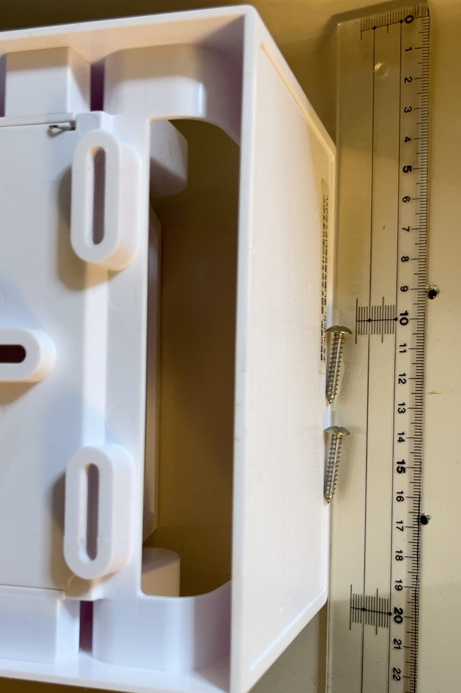
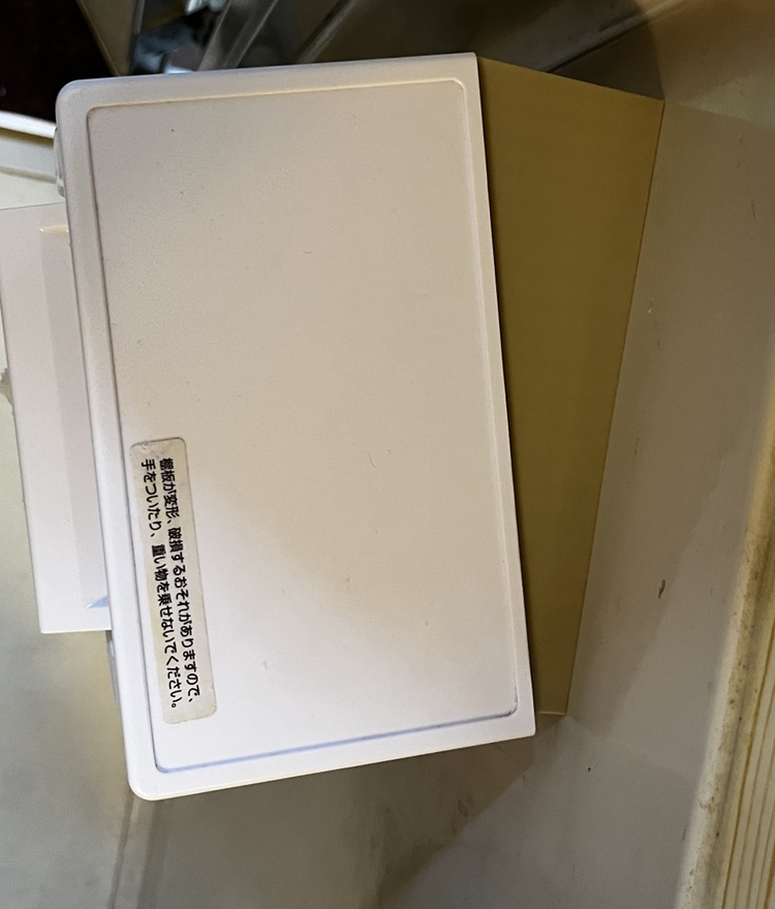
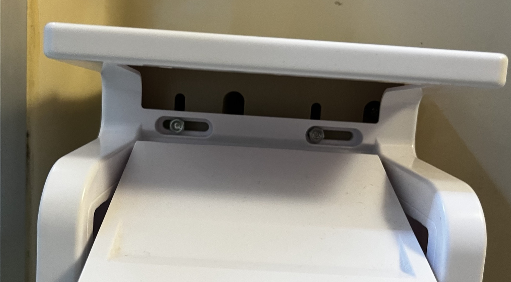
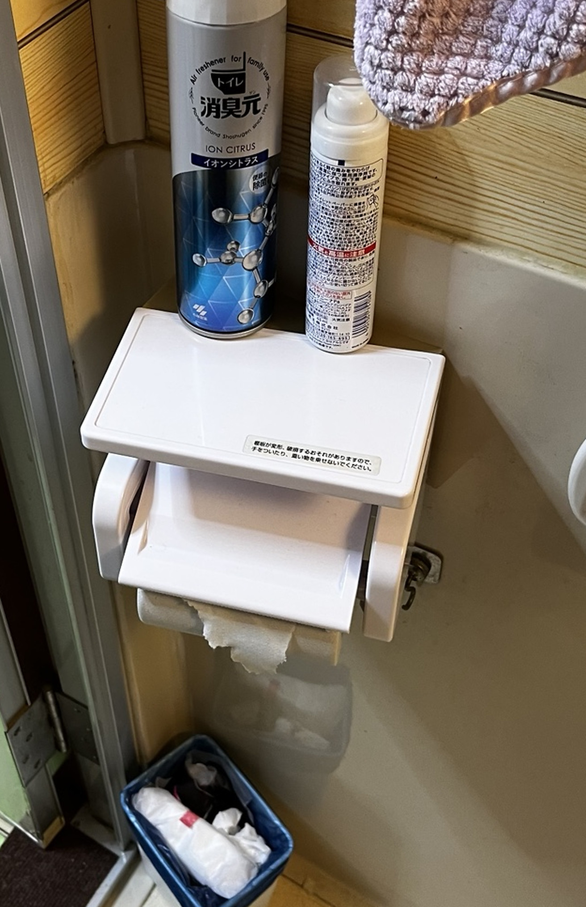

# Toilet-paper holder wedge adapter — V10 (completed installation)

- Date: 2026-10-30
- Project: 3D-printed angled adapter for an existing wall-mounted toilet-paper holder
- Output: Bambu Lab A1 mini, 10° and 15° design variants
- Result: the user reported installation complete and supplied three photos.
- **Installed variant confirmed by the user: 15°.** The 10° model is an alternative design file, not the photo-proven installation. Photos document assembly, not independent stress/load testing.
- Playbook: [Practical 3D Printing](../../../skills/3d-print-practical/SKILL.md)

## Downloads

- [Both variants, STL, editable SCAD and validation logs (ZIP)](wedge_v10.zip)
- [10° Bambu Studio 3MF](wedge_v10_10.3mf)
- [15° Bambu Studio 3MF](wedge_v10_15.3mf)

ZIP SHA-256: `4a598c2c06371bdb62d5ad6274aee206d73f67e2a83ef7b1a8ed8daf993a2353`

## What the user needed

An offset/tilt adapter between an existing wall plate and the original toilet-paper holder so that the holder tilts toward the user. Left/right reversibility and adjustment space were requirements. The existing wall mounting holes must not be moved without cause. The physical holder has two horizontally elongated slots; the wall mounting plate has multiple candidate openings. A ruler placed against the real parts was the primary source for measurements.

## Iterative development and what failed

1. First, the user followed the AI's instructions to photograph real hardware with a ruler and measure a simple 3 mm shim to prevent lateral movement. The initial shim mistakenly included screw holes. After removing holes, three narrow strips fitted in the field. **Those ruler photographs are of the initial shim/hardware measurement, not proof that the later wedge holes had been dimensioned correctly.**
2. Initial wedge concepts placed the holder bolts through excessive wedge thickness; the bolt length became impractical. Reworked the angled holder-side skin to 5 mm **normal to the inclined face** and opened room for nuts/tools. An extra nut adapter was later removed as unnecessary.
3. Despite careful ruler-based measurement, the AI then **overlooked the actual correspondence between the wall holes and the holder's existing slots**. Early wedge geometry used the wall pitch (76 mm) and an assumed 108 mm holder pitch as if they defined installation positions. This ignored the real length and orientation of the holder's horizontal slots. Holes ended too far apart, and a physically workable correspondence was not demonstrated.
4. Multiple revisions shifted/illustrated hole positions. A reference diagram even drew wall and holder holes at different vertical positions for legibility, misleading the reviewer. The user requested no unnecessary diagrams: verify the **actual 3D data** instead.
5. Some revisions had insufficient material near a nut recess, and some were technically watertight but still unfit for assembly. Mesh validity alone was never an adequate acceptance criterion.
6. V10 adopted the practical insight: the original installation already worked with a 76 mm screw pitch. Keep the **two wall holes fixed** and choose holder mounting points 76 mm apart **measured on the tilted face**, leveraging the original holder's slot adjustability. This simplified the constraints and brought the holes inward.
7. The user eventually installed a printed part and supplied top, mounting, and in-use photos as completion evidence.

## V10 model notes

- Body footprint: 158 × 60 mm.
- Wall slot centers: X=-6 and +70 mm (76 mm pitch), Y=0. These are the previously adopted wall coordinates.
- Holder slot centers: separated by 76 mm along the tilted face, with angle-dependent projected pitch.
- Inclined face: the holder-side remaining plastic skin is 5 mm in the face-normal direction.
- Both sides have their intended nut/bolt access; no extra printed nut adapter.
- Hole centerlines are not artificially staggered vertically.
- Design variants: 10° and 15°. **The user installed the 15° variant and reported completion.**
- ZIP contains the original generation checks. Those checks say physical assembly NOT_RUN *at generation time*; the subsequent user completion photographs are an additional, later acceptance observation.

## Assembly and limitations

Confirm screw diameter, length, head/washer footprint, nut/tool access, the orientation of the wall plate, and the available holder slots on **your own** fitting. Do not assume another brand uses the same geometry. Material choice, layer orientation and load behavior have not been independently tested. This model is an example of user-directed, measured-and-iterated DIY—not a universal replacement part.

## Actual holder measurement photographs (corrected source selection)

**Correction (2026-10-30):** The first publication mistakenly illustrated the wedge measurement with photos from the earlier **3 mm anti-shift shim** project. Those were the wrong source images. The following photos are from the separate **holder wedge** measurements in the earlier "angled adapter" conversation:

1. The original holder measured across the front before removal, with a ruler on the holder top.
2. The detached holder underside with its two elongated mounting slots, screw hardware and ruler visible together. This is the decisive photo of the *holder-side* connection.

The user measured according to the AI-guided process, but the AI later treated the wall-side mounting coordinates and holder-side adjustable slots inconsistently. This illustrates the failure: **a correct measurement workflow is not enough without an explicit fastener/slot correspondence check in the assembled coordinate system**. The original shim ruler photos are retained as historical artifacts only; do not mistake them for the wedge evidence.

## Installation photos — user-confirmed 15°

The cropped photos were enlarged with standard image interpolation; this raises output pixel dimensions but does not recover new camera detail. EXIF metadata was removed. Original earlier compressed images remain in this case for comparison.

## Public blog post

[Japanese write-up with the measurement-to-oversight story and V10 downloads](https://campsite7.jp/2026/10/30/3d-printed-toilet-holder-wedge-v10/)
